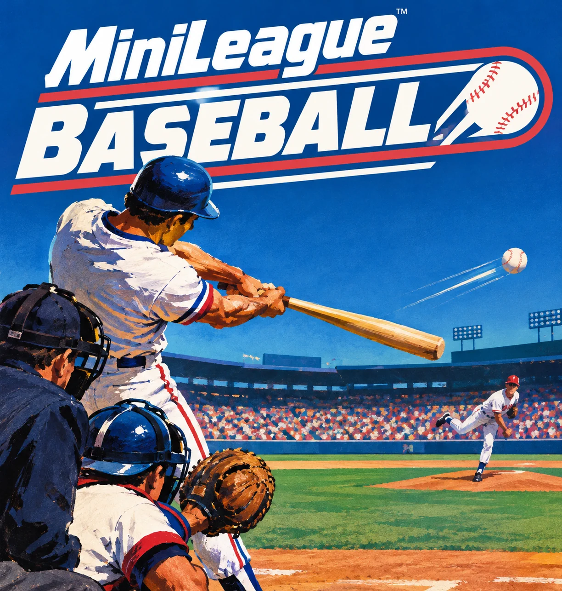
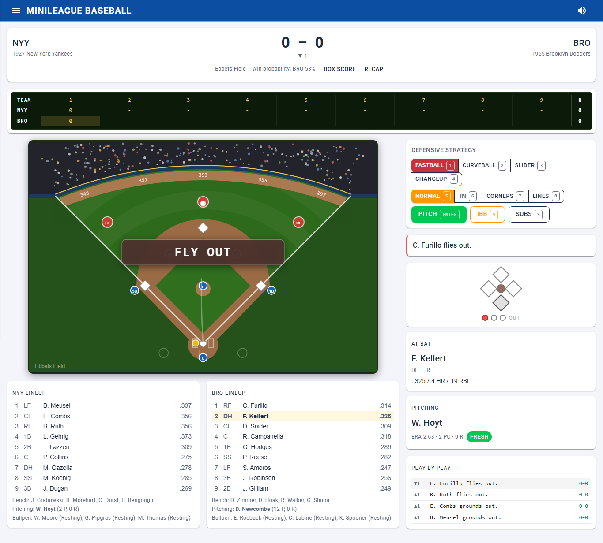

<p align="center">
  
</p>

<h1 align="center">MiniLeague Baseball</h1>

<p align="center">
  A modern recreation of the 1984 <em>MicroLeague Baseball</em> simulation.<br />
  Be the manager. Put the 1927 Yankees up against the 1982 Brewers, call every pitch and strategy, and watch real statistics decide the result.
</p>

<p align="center">
  <strong>Play now: <a href="https://josemoliver.github.io/MiniLeagueBaseball/">https://josemoliver.github.io/MiniLeagueBaseball/</a></strong>
</p>

MiniLeague Baseball is a **manager's game, not an arcade game**: you never swing or throw. You choose the lineup, the starting pitcher, the pitch, the defensive alignment, the steal, the bunt, the pinch hitter and the pitching change, and a probability engine fed with real season statistics resolves each plate appearance.

It runs **entirely in the browser** (Blazor WebAssembly), so it needs no server, installs like an app, and works offline.

<p align="center">
  
</p>

## Features

**Teams and data**
- 15 classic teams from 1927 to 1982, with real batting, pitching and fielding statistics from the [Lahman Baseball Database](https://sabr.org/lahman-database/).
- Each team plays in its real ballpark, with its fence distances and park factors for home runs, extra-base hits and overall scoring.
- Add your own teams and parks by dropping in a JSON file (see [Adding teams](#adding-teams-and-ballparks)).

**Managing the game**
- Offense: swing away, aggressive, safe, steal, hit and run, sacrifice. Defense: pitch type, infield in, corners in, guard the lines, intentional walk.
- Edit the batting order and fielding positions before the game, and pick any pitcher to start.
- Pinch hit, pinch run, replace a fielder, swap positions. A reliever has to warm up first: too little and he comes in cold, too long and he is stale.
- Play as the visitors, the home team, both teams (two players, one screen), or watch the computer play itself.
- Keyboard shortcuts for everything, with printable cards (menu → **Keyboard Cards**).

**Realism**
- Pitchers tire by pitch count and their own durability, and a computer manager pulls them.
- Fielding matters: range, error rates and arm strength per position. Errors happen at each season's real rate, and a bench bat playing shortstop is a liability.
- Optional random events: injuries that force a replacement, rain delays that can end a game, and manager ejections that hand your team to the computer.
- A computer manager that pinch hits, pinch runs, warms up and changes pitchers, and tidies its defense after substitutions.

**After and around the game**
- A full box score with earned runs, decisions (W, L, S) and left on base, as plain text you can copy or print.
- A game recap: a win-probability chart, the story of the game, the biggest plays and the standout players.
- Autosave to the browser; pick the game up where you left it.
- Sound: synthesized effects, and a ballpark organ that plays *Charge!* at the start, *Take Me Out to the Ball Game* at the seventh-inning stretch, the Mexican Hat Dance for a rally, and more.
- Layouts for phones, laptops and wide monitors. Installable as an app (PWA) and playable offline.

## The teams

| Year | Team | Ballpark |
|---|---|---|
| 1927 | New York Yankees | Yankee Stadium |
| 1955 | Brooklyn Dodgers | Ebbets Field |
| 1961 | New York Yankees | Yankee Stadium |
| 1963 | Los Angeles Dodgers | Dodger Stadium |
| 1967 | St. Louis Cardinals | Busch Memorial Stadium |
| 1968 | Detroit Tigers | Tiger Stadium |
| 1969 | New York Mets | Shea Stadium |
| 1970 | Baltimore Orioles | Memorial Stadium |
| 1973 | Oakland Athletics | Oakland-Alameda County Coliseum |
| 1975 | Cincinnati Reds | Riverfront Stadium |
| 1975 | Boston Red Sox | Fenway Park |
| 1979 | Pittsburgh Pirates | Three Rivers Stadium |
| 1980 | Philadelphia Phillies | Veterans Stadium |
| 1980 | Kansas City Royals | Royals Stadium |
| 1982 | Milwaukee Brewers | Milwaukee County Stadium |

## Getting started

You need the [.NET 10 SDK](https://dotnet.microsoft.com/download). Node.js 20 or later is only needed to run the JavaScript tests, and Python 3 only to regenerate the team data.

```bash
git clone <this repository>
cd MiniLeagueBaseball

dotnet run --project src/MiniLeague.Web
```

Then open <http://localhost:5248>. On Windows, `./build.ps1 -Action Run 5001` does the same on a port you choose (`Build`, `Restore` and `Clean` are also available).

### Playing

1. Press **PLAY BALL**, choose the two teams, who you manage, the ballpark and the starting pitchers, and optionally edit either lineup.
2. On your turn pick a strategy and press **PITCH**. Use **SUBS** for the bench, the bullpen and position changes, and **Box score** or **Recap** at any time.
3. Prefer the keyboard? Offense: `1`–`6` pick the strategy. Defense: `1`–`4` the pitch, `5`–`8` the alignment, `9` an intentional walk. `Enter` or `P` plays the pitch, `S` opens substitutions, `B` the box score. If you manage both teams, hold `Shift` for the defense keys.

## How it works

Each plate appearance is a weighted roll over the possible outcomes. The batter's per-appearance rates are scaled by the pitcher's quality (his ERA, walks and strikeouts, reduced by fatigue), then adjusted for the ballpark, the pitch chosen, the defensive alignment and the fielders' range. A ball hit to a fielder for an out can become an error at that season's real rate, and the runners then advance according to speed, outfield arms and the manager's strategy.

The computer manager is rule based. It decides situationally: bunt, steal, pinch hit, warm up a reliever, bring in the closer for a save, or pull a starter who is tiring or getting shelled.

## Project layout

```
src/
  MiniLeague.Engine/     The game itself: models, simulation, computer manager, game flow,
                         box score, recap and win probability. A plain class library with no UI.
  MiniLeague.Web/        The Blazor WebAssembly app: pages, components, sounds, PWA files,
    wwwroot/data/          team and ballpark JSON
tests/
  MiniLeague.Engine.Tests/   xUnit tests for the engine, including hundreds of simulated games
  MiniLeague.Web.Tests/      bUnit tests that render the real pages and dialogs
  js/                        Node tests for the sound code and the offline service worker
tools/
  generate_teams.py      Builds the team, ballpark and fielding JSON from the Lahman database
  sound-preview.html     Open in a browser to hear every sound and organ tune
docs/                    The original planning document, and screenshots
```

## Adding teams and ballparks

Every team is a JSON file in `src/MiniLeague.Web/wwwroot/data/teams/`, listed in `teams.json`. The first nine entries in `batters` are the starting lineup in batting order and the rest are the bench:

```json
{
  "id": 11, "city": "Boston", "nickname": "Red Sox", "abbreviation": "BOS",
  "season": 1975, "league": "AL", "stadium": "fenway-1975",
  "batters": [
    { "id": 1101, "name": "J. Rice", "pos": "LF", "bats": "Right", "throws": "Right",
      "ab": 564, "h": 174, "hr": 22, "bb": 36, "so": 122, "d2": 29, "d3": 4, "sb": 10, "speed": 3,
      "field": { "LF": [4, 3, 3] } }
  ],
  "pitchers": [
    { "id": 1150, "name": "L. Tiant", "throws": "Right", "era": 4.02, "ip": 260, "h": 262, "bb": 72, "so": 142,
      "tiringFactor": 3, "role": "Starter", "wins": 18, "losses": 14 }
  ]
}
```

Ballparks live in `stadiums.json` (fence distances, wall heights and park factors). To rebuild all 15 shipped teams from the Lahman CSV files (`Batting`, `Pitching`, `People`, `Appearances`, `Fielding` and `Teams`):

```bash
python tools/generate_teams.py <folder with the Lahman CSV files>
```

## Tests

```bash
dotnet test MiniLeagueBaseball.slnx                              # engine and UI tests
node --test tests/js/sound.test.js tests/js/pwa.test.js          # sound and offline tests
```

The engine tests play hundreds of full games and check that the rules always hold: every game ends legally, the box score adds up, runners are never lost, and errors, pitching changes and random events happen at realistic rates. To hear the sounds, open `tools/sound-preview.html` in a browser.

## Deployment

The game is a static site and is published to **GitHub Pages** at <https://josemoliver.github.io/MiniLeagueBaseball/>. The workflow in `.github/workflows/pages.yml` runs the tests, publishes with `dotnet publish src/MiniLeague.Web -c Release -o publish`, sets the project-site base path, and deploys on every push to `main`. Pages must be set to "GitHub Actions" as its source in the repository settings.

Any other static host works too. It needs to send unknown paths to `index.html`, as `staticwebapp.config.json` does for Azure Static Web Apps.

## Data, credits and disclaimer

- Player and team statistics come from the [Lahman Baseball Database](https://sabr.org/lahman-database/) by Sean Lahman, used under [CC BY-SA](https://creativecommons.org/licenses/by-sa/3.0/). Ballpark fence distances were entered by hand from memory of the real parks and are approximate. Details are in [`ATTRIBUTION.md`](src/MiniLeague.Web/wwwroot/data/ATTRIBUTION.md).
- The organ melodies are public-domain compositions; their sources are credited in the same file.
- This is an independent fan project inspired by *MicroLeague Baseball* (1984). It is not affiliated with or endorsed by MicroLeague, Major League Baseball or the players' association.

## License

The source code is released under the [MIT License](LICENSE). The team data derived from the Lahman database (`src/MiniLeague.Web/wwwroot/data`) remains licensed [CC BY-SA](https://creativecommons.org/licenses/by-sa/3.0/); see [`ATTRIBUTION.md`](src/MiniLeague.Web/wwwroot/data/ATTRIBUTION.md).
